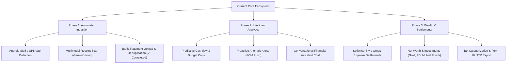

# Future Possible Features & Upgrade Roadmap

> **Document Status**: Strategic AI & Developer Roadmap  
> **Purpose**: Catalog potential high-value upgrades, architectural extensions, and instructions for how an AI coding assistant should implement them when requested.

---

## 🚀 Future Feature Pipeline

The following features have been architected to fit naturally into the existing polyrepo ecosystem (Next.js + Flutter + Google Sheets / SQLite):



---

## 📋 Detailed Feature Specifications & Implementation Blueprints

### 1. 📲 Android SMS & UPI Notification Auto-Capture
- **Description**: Listen to incoming SMS messages (from banks like SBI, HDFC, ICICI, Federal Bank) and UPI notifications (Google Pay, PhonePe, Paytm). Automatically parse transaction amounts, merchants, debit/credit flags, and prompt user for 1-tap confirmation or auto-log into SQLite.
- **Mobile Components**:
  - Add `telephony` / `flutter_sms_inbox` or `notification_listener_service` plugin to `manikutti_mobile`.
  - Android native permissions: `RECEIVE_SMS`, `READ_SMS`, `BIND_NOTIFICATION_LISTENER_SERVICE`.
  - Service: `lib/services/sms_parser_service.dart`.
  - RegEx rules engine for standard Indian banking formats (`debited by INR [0-9]+`, `VPA [a-zA-Z0-9]+`).
- **Sheets / Backend**:
  - Log into standard `Personal_Expenses` or mark with tag `Source: SMS_Auto`.
- **AI Implementation Guide**:
  1. Add plugin to `pubspec.yaml`.
  2. Implement local background listener in Android foreground service.
  3. Format parsed payload into `TransactionModel` with `synced = 0`.
  4. Display local heads-up notification asking "Confirm Expense of ₹X at Y?".

---

### 2. 🎙️ Voice Expense Logging (Multilingual Malayalam & English)
- **Description**: Allow family members (especially non-tech-savvy elders) to press a microphone button on the Flutter dashboard and speak naturally (e.g. *"ഇന്ന് മീൻ വാങ്ങാൻ 250 രൂപ ചെലവായി"* or *"Auto rickshaw 60 rupees"*).
- **Mobile Components**:
  - `speech_to_text` Flutter package or record audio snippet via `record` package.
  - Floating Voice Mic button on `lib/screens/dashboard_screen.dart`.
- **Backend Components**:
  - Route: `Manikutti/src/app/api/ai/voice-transcribe/route.ts`.
  - Pass audio or transcribed text to Gemini 2.5 Flash with structured output JSON schema:
    ```json
    { "amount": 250, "category": "Food & Groceries", "note": "Fish purchase", "type": "Expense" }
    ```
- **AI Implementation Guide**:
  1. Add speech capture widget in `lib/widgets/voice_input_fab.dart`.
  2. Send query to API or run client-side audio stream.
  3. Pre-populate `AddTransactionScreen` with extracted values for confirmation.

---

### 3. 🖼️ Multimodal Receipt & Invoice Scanning with Gemini Vision
- **Description**: Upgrade the current regex-based Google ML Kit text recognition (`smart_scan_screen.dart`) to multimodal Gemini Vision AI. Able to parse handwritten store receipts, restaurant bills with itemized taxes, and complex electricity bills.
- **Components**:
  - Endpoint: `Manikutti/src/app/api/ai/scan-receipt/route.ts`.
  - Upload receipt image (base64) to serverless route, call Gemini Vision `models/gemini-2.5-flash:generateContent`.
  - Output structured line items, merchant name, date, total tax, and total amount.
- **AI Implementation Guide**:
  1. Connect `SmartScanScreen` to POST `/api/ai/scan-receipt`.
  2. Fall back to local Google ML Kit regex if offline.

---

### 4. 🎯 Category-Based Monthly Budget Caps & Overspend Alerts
- **Description**: Allow users and families to set monthly budget limits per category (e.g., Dining: ₹5,000, Groceries: ₹12,000). Display progress bars (Green < 70%, Yellow 70-90%, Red > 90%) and alert when spending is approaching limits.
- **Sheets Storage**:
  - New tab in Personal Sheet: `Category_Budgets` (`[Category, MonthlyLimit, AlertThresholdPercent]`).
- **Web & Mobile Components**:
  - Web: Category progress bars in `PersonalDashboard.tsx`.
  - Mobile: Budget summary cards in `dashboard_screen.dart` and push notification trigger in `NotificationService`.
- **AI Implementation Guide**:
  1. Add `Category_Budgets` to `ensureSheetsExist()` in `googleSheets.ts`.
  2. Create API endpoint `/api/sheets/budgets`.
  3. Calculate monthly total per category and compare against limit.

---

### 5. 🤝 Splitwise-Style Group Bill Splitting & Settle Up
- **Description**: Enable family members or trip groups to split expenses unequally (by shares, percentage, or exact amounts) and calculate minimum cash transactions required to settle balances ("A owes B ₹300").
- **Sheets Storage**:
  - New tab in Family Sheet: `Group_Splits` (`[SplitID, Date, Description, TotalAmount, PaidBy, SplitDetailsJSON, SettledStatus]`).
- **Components**:
  - Web: `src/app/splits/page.tsx` with debt simplification graph algorithm.
  - Mobile: Split calculation screen and "Settle Up" action.
- **AI Implementation Guide**:
  1. Implement greedy debt simplification algorithm (`simplifyDebts(balances)`).
  2. Record settlement transactions in `Family_Expenses` when a debt is cleared.

---

### 6. 📈 Investment, Gold & Net Worth Tracker
- **Description**: Track non-liquid family assets including Sovereign Gold Bonds (SGB), physical gold, Fixed Deposits (FD), Mutual Funds (SIP), and Employee Provident Fund (EPF).
- **Sheets Storage**:
  - New tab in Family Sheet: `Assets_Portfolio` (`[AssetType, Name, Quantity, PurchaseValue, CurrentValue, LastUpdated]`).
- **Web & Mobile Components**:
  - Dashboard widget showing total net worth: `Total Liquid Cash + Investments - Outstanding Loans`.
- **AI Implementation Guide**:
  1. Add asset management UI tab in `AdminDashboard.tsx`.
  2. Provide gold price API integration (e.g. Gold Price in Kerala / India live feed).

---

### 7. 📑 PDF/Excel Export & Tax Categorization (Form 16 / ITR)
- **Description**: One-click generation of PDF statements for any date range, and annual tax-deductible expense summaries (Section 80C, 80D health insurance, home loan interest Section 24b).
- **Web Components**:
  - `jspdf` / `xlsx` integration in `Manikutti/src/components/ExportModal.tsx`.
  - API `/api/sheets/export`.
- **AI Implementation Guide**:
  1. Query `GoogleSheetsService` for date range.
  2. Generate styled PDF with summary graphs and categorized ledger table.

---

## 🛠️ Step-by-Step AI Guide for Upgrading Features

When an AI assistant is asked to implement any upgrade from this roadmap:
1. **Branch**: Ensure you are on a feature branch (`git checkout -b feature/<upgrade-name>`).
2. **Schema First**: Check if Google Sheets tabs or SQLite columns need updating (`googleSheets.ts` `ensureSheetsExist()` and `db_helper.dart` `onUpgrade()`).
3. **API Contracts**: Update or create endpoints in `Manikutti/src/app/api/`. Test using curl or mock payload.
4. **Offline Mobile Logic**: If the mobile app is affected, update SQLite schema, `TransactionModel`/new model, `ApiService`, and `SyncService`.
5. **UI & Localization**: Add text keys to both `lib/l10n/app_en.arb` and `lib/l10n/app_ml.arb`, then run `flutter gen-l10n`.
6. **Documentation Sync**: Update [`FEATURE_MAP.md`](FEATURE_MAP.md) and the corresponding feature document in `docs/features/`.
