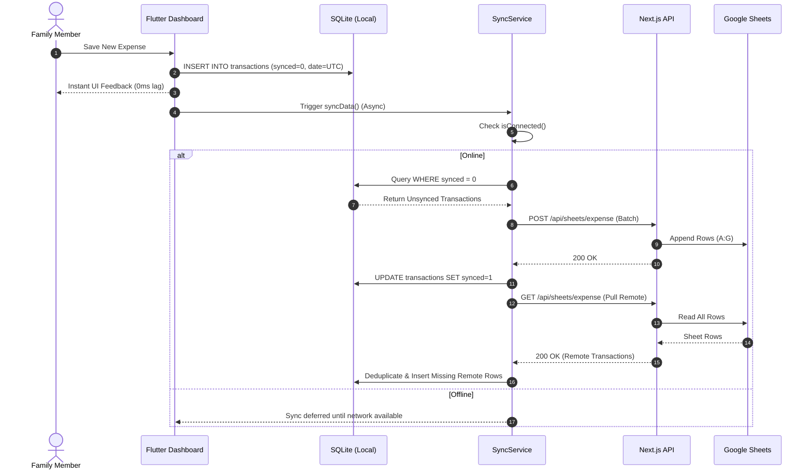

# Feature 04: Offline-First Synchronization Engine

## 1. Overview & Purpose
The Offline-First Sync Engine ensures that family members can record and view financial transactions on their mobile devices without latency or dependence on active internet connectivity. It uses a local SQLite store on the device, monitors network status, performs background sync tasks, and neutralizes timezone discrepancies between mobile handsets and cloud servers using UTC normalization and deduplication.

---

## 2. Source Files & Implementation Matrix

### Mobile Client (`manikutti_mobile`)
- [`lib/database/db_helper.dart`](file:///d:/MERN/Personal/my-apps/finance-tracker/manikutti_mobile/lib/database/db_helper.dart):
  - SQLite database initializer (`manikutti.db`, version 2).
  - Schema for `transactions` table with `synced INTEGER NOT NULL` column (0 = local pending, 1 = synced to cloud).
  - Methods: `insertTransaction()`, `getUnsyncedTransactions()`, `markAsSynced()`, `getAllTransactions()`.
- [`lib/services/sync_service.dart`](file:///d:/MERN/Personal/my-apps/finance-tracker/manikutti_mobile/lib/services/sync_service.dart):
  - `isConnected()`: Connectivity check using `connectivity_plus`.
  - `syncData()`: Master orchestrator executing `pushLocalChanges()` followed by `pullRemoteChanges()`.
  - `pushLocalChanges()`: Gathers pending transactions (`synced = 0`), sends them to `/api/sheets/expense` or `/api/sheets/family`, and updates SQLite.
  - `pullRemoteChanges()`: Fetches remote records and merges into SQLite, avoiding duplicates via UTC comparison.
- [`lib/main.dart`](file:///d:/MERN/Personal/my-apps/finance-tracker/manikutti_mobile/lib/main.dart):
  - `Workmanager().initialize(callbackDispatcher)`: Periodic background sync and push notification check every 15 minutes.
- [`lib/models/transaction_model.dart`](file:///d:/MERN/Personal/my-apps/finance-tracker/manikutti_mobile/lib/models/transaction_model.dart):
  - Serializers `toMap()`, `fromMap()`, `toSheetRow()`, `fromSheetRow()`.

### Backend API (`Manikutti`)
- `/api/sheets/expense/route.ts` & `/api/sheets/family/route.ts`:
  - Receives transaction payloads, validates fields, and appends to Google Sheets.
  - Returns current sheet rows for pull reconciliation.

---

## 3. Data Flow & Sync Mechanics



---

## 4. UTC Normalization & Duplicate Prevention

### The Problem
When a mobile user in India (UTC+5:30) creates an expense at 10:00 PM IST on Oct 10, the local date string is `2026-10-10`. If converted to UTC on a Vercel server, it becomes `2026-10-10 16:30:00 UTC`. Discrepancies between local string representations caused duplicate entries during bidirectional syncing.

### The Solution Contract
1. **Always Convert to UTC**: All dates generated in `manikutti_mobile` MUST be normalized before storage and sync:
   ```dart
   final String normalizedDate = selectedDate.toUtc().toIso8601String();
   ```
2. **Deduplication Key**:
   When pulling remote transactions from Google Sheets, the sync engine matches existing local records against:
   ```
   [Date_UTC, Amount, Category, Note, Type]
   ```
   If a matching record is already in SQLite, it is skipped rather than re-inserted.

---

## 5. Edge Cases & Resilience

- **Interrupted Network**: If connection drops mid-push, the transaction remains `synced = 0` in SQLite and will be retried safely during the next sync cycle.
- **Concurrent Device Edits**: Multiple family members can insert offline simultaneously. Because transactions are append-only with UTC timestamps, Google Sheets row appends do not overwrite each other.
- **Background Battery Optimization**: `Workmanager` handles Android OS Doze mode, scheduling sync tasks within OS battery constraints.

---

## 6. Future Possible Upgrades

- **WebSocket / SSE Real-time Updates**: Real-time push from Next.js server to mobile whenever another family member records an expense.
- **Delta Sync with Row Versioning**: Instead of pulling all sheet rows, pass `?since=<last_sync_timestamp>` to pull only newly modified rows.
- **Conflict Resolution UI**: Interactive dialog when two users edit the same transaction metadata simultaneously.

---

## 7. AI Modification & Maintenance Instructions

- When modifying sync logic:
  1. Never write directly to the network without writing to SQLite first.
  2. Always test the offline flow: verify that the app functions normally with Wi-Fi/Mobile Data disabled.
  3. Never alter the UTC serialization format in `TransactionModel` without providing an SQLite migration in `db_helper.dart`.
