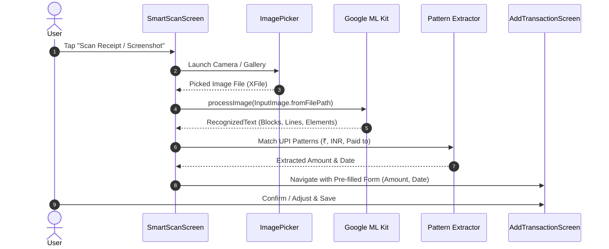

# Feature 08: Smart Scan & Receipt / Payment OCR

## 1. Overview & Purpose
Smart Scan streamlines expense logging by eliminating manual keyboard typing. Using on-device machine learning (Google ML Kit Text Recognition), the Flutter app scans payment confirmation screens (Google Pay, PhonePe, Paytm), physical retail receipts, or fuel bills directly from camera snapshots or saved gallery screenshots, extracting transaction amounts and dates automatically.

---

## 2. Source Files & Implementation Matrix

### Mobile Client (`manikutti_mobile`)
- [`lib/screens/smart_scan_screen.dart`](file:///d:/MERN/Personal/my-apps/finance-tracker/manikutti_mobile/lib/screens/smart_scan_screen.dart):
  - Camera / Gallery image picker using `image_picker`.
  - ML Kit Text Recognizer initialization:
    ```dart
    final textRecognizer = TextRecognizer(script: TextRecognitionScript.latin);
    final RecognizedText recognizedText = await textRecognizer.processImage(inputImage);
    ```
  - RegEx extraction algorithms for Indian UPI apps (Google Pay, PhonePe, Paytm).
  - Previews extracted amount and offers "Create Expense" button.
- [`lib/screens/screenshots_screen.dart`](file:///d:/MERN/Personal/my-apps/finance-tracker/manikutti_mobile/lib/screens/screenshots_screen.dart):
  - Screenshot management view for bulk processing recent payment receipt screenshots.
- Native Plugins Used:
  - `google_mlkit_text_recognition`: On-device Latin script OCR.
  - `image_picker`: Device camera and gallery interface.

---

## 3. Data Flow & Mechanics



---

## 4. Extraction Patterns & Regex Logic

### Current Extraction Rules
- Currency Symbol Match:
  ```dart
  final amountExp = RegExp(r'[₹|Rs\.?|INR]\s?([0-9,]+(\.[0-9]{1,2})?)');
  ```
- Google Pay UPI Success Screen:
  Looks for keywords `"Paid to"`, `"Completed"`, `"UPI Transaction ID"`.
- PhonePe Success Screen:
  Looks for `"Payment Successful"`, `"Debited from"`.

---

## 5. Edge Cases & Validation Rules

- **On-Device Offline Capability**: The OCR runs 100% on the device CPU/GPU without sending images to external servers, protecting user privacy and functioning completely offline.
- **Ambiguous Numbers**: If multiple amounts are found (e.g. Total, Discount, Subtotal), the algorithm extracts the largest currency amount preceded by keywords like `"Total"`, `"Paid"`, or `"Net Amount"`.
- **Low Light / Blurry Images**: If no valid currency patterns are detected, the screen prompts the user with the raw recognized text and lets them type the amount manually.

---

## 6. Future Possible Upgrades

- **Gemini Multimodal Cloud Vision**: For complex multi-item invoices or grocery store receipts, add an optional cloud toggle calling Gemini 2.5 Flash to extract every individual line item into a categorized breakdown.
- **Merchant Auto-Categorization**: Dictionary lookup mapping merchant names (e.g. "Indian Oil" ➡️ "Fuel", "Lulu Hypermarket" ➡️ "Groceries", "Swiggy" ➡️ "Food & Dining").
- **Automatic Screenshot Detection**: Android ContentObserver watching `/DCIM/Screenshots` to ask "New payment screenshot detected. Log expense?".

---

## 7. AI Modification & Maintenance Instructions

- When updating Smart Scan:
  1. Always release ML Kit resources properly: `textRecognizer.close()`.
  2. Handle null image picks gracefully when the user cancels the camera/gallery picker.
  3. Keep the extracted amount normalized by removing commas (e.g. `1,250.00` ➡️ `1250.00`).
