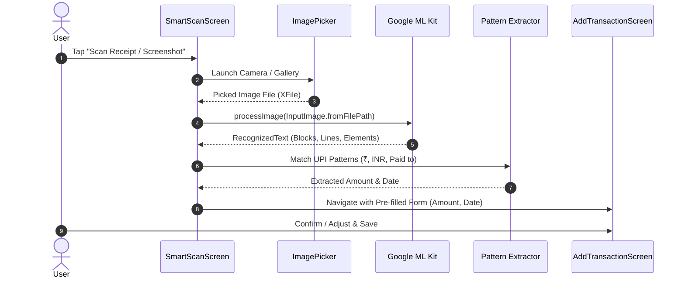

# Feature 08: Smart Scan & Receipt / Payment OCR

## 1. Overview & Purpose
Smart Scan streamlines expense logging by eliminating manual keyboard typing. Using on-device machine learning (Google ML Kit Text Recognition), the Flutter app scans payment confirmation screens (Google Pay, PhonePe, Paytm), physical retail receipts, or fuel bills directly from camera snapshots or saved gallery screenshots, extracting transaction amounts and dates automatically.

---

## 2. Source Files & Implementation Matrix

### Web API (`Manikutti`)
- [`src/app/api/ai/extract-screenshot/route.ts`](file:///d:/MERN/Personal/my-apps/finance-tracker/Manikutti/src/app/api/ai/extract-screenshot/route.ts):
  - Checks Admin `aiEnabled` master flag and user's `ai_screenshot_extraction` permission via Firestore / `Roles_Permissions`.
  - Runs free-tier `gemini-2.5-flash-lite` (fallback `gemini-2.5-flash`) with OCR text first; accepts compressed base64 image only if OCR text is sparse; returns deterministic local extraction fallback if Gemini quota/key is unavailable.

### Mobile Client & Android Native (`manikutti_mobile`)
- [`android/app/src/main/kotlin/com/abhilash/manikutti/MainActivity.kt`](file:///d:/MERN/Personal/my-apps/finance-tracker/manikutti_mobile/android/app/src/main/kotlin/com/abhilash/manikutti/MainActivity.kt), `AndroidManifest.xml`, and `res/xml/file_paths.xml`:
  - Declares `ACTION_SEND` (`image/*`) intent filter to receive payment screenshots shared directly from GPay/PhonePe/Paytm/Gallery (cold start and `onNewIntent`).
  - Copies `content://` streams to app cache and delivers paths via MethodChannel `com.abhilash.manikutti/share` (`getInitialSharedImage`, `shareImage`).
  - Uses `FileProvider` + WhatsApp `<queries>` (`com.whatsapp`, `com.whatsapp.w4b`) to forward receipts back to WhatsApp after logging.
- [`lib/services/screenshot_payee_rule_service.dart`](file:///d:/MERN/Personal/my-apps/finance-tracker/manikutti_mobile/lib/services/screenshot_payee_rule_service.dart) & [`lib/screens/payee_rules_screen.dart`](file:///d:/MERN/Personal/my-apps/finance-tracker/manikutti_mobile/lib/screens/payee_rules_screen.dart):
  - Stores user-defined Payee / Phone Number / UPI ID rules mapping frequent recipients (e.g., savings transfers or mom's home loan payments) to a fixed Category, Destination (`Personal` | `Family` | `Home Loan + Family`), optional linked `Monthly_Expenses` due to mark `Paid`, and optional `Family_Transfers` pool transfer.
  - Phone numbers match on digit-normalized last 10 digits (`+91 98765-43210` matches `9876543210`).
- [`lib/services/screenshot_extractor_service.dart`](file:///d:/MERN/Personal/my-apps/finance-tracker/manikutti_mobile/lib/services/screenshot_extractor_service.dart):
  - **Stage 1 (0 cost)**: On-device ML Kit `TextRecognizer`.
  - **Stage 2 (Gated by `ai_screenshot_extraction`)**: Calls `/api/ai/extract-screenshot` with OCR text (or image only if `< 18` chars / `amount <= 0`).
  - **Stage 3 (Offline deterministic fallback)**: `extractLocally()` Indian UPI/bank regex + merchant category dictionary while skipping 12-digit UTR/reference numbers.
  - **Highest-Priority Rule Override (`applyPayeeRuleSync`)**: Applies matching `ScreenshotPayeeRule` on top of both local & Gemini extraction so saved recipients always resolve to their configured category & ledger.
- [`lib/screens/share_expense_sheet.dart`](file:///d:/MERN/Personal/my-apps/finance-tracker/manikutti_mobile/lib/screens/share_expense_sheet.dart):
  - Pre-filled confirmation sheet triggered by OS Share intent or `ScreenshotsScreen`.
  - 3-way destination selector: **Personal** (`Personal_Expenses`), **Family** (`Family_Expenses`), or **Home Loan** (records daily reducing-balance repayment in `HomeLoan_Ledger`, logs to `Family_Expenses`, and marks matching `Monthly_Expenses` due as `Paid`).
  - Includes 1-tap **"Remember category & destination for this payee/number"** rule creation, plus **Log & Notify** (UTC `.toUtc().toIso8601String()`) and **Log & WhatsApp**.
- [`lib/screens/smart_scan_screen.dart`](file:///d:/MERN/Personal/my-apps/finance-tracker/manikutti_mobile/lib/screens/smart_scan_screen.dart):
  - Camera / Gallery image picker using `image_picker` with on-device ML Kit OCR.
- [`lib/screens/screenshots_screen.dart`](file:///d:/MERN/Personal/my-apps/finance-tracker/manikutti_mobile/lib/screens/screenshots_screen.dart):
  - Gallery/Camera payment screenshot scanner with session history launching `ShareExpenseSheet`.
- Native Plugins Used:
  - `google_mlkit_text_recognition`: On-device Latin script OCR.
  - `image_picker`: Device camera and gallery interface.

---

## 3. Data Flow & Mechanics



---

## 4. Extraction Patterns & Regex Logic

### Current Extraction Rules
- Currency Symbol Match:
  ```dart
  final amountExp = RegExp(r'[₹|Rs\.?|INR]\s?([0-9,]+(\.[0-9]{1,2})?)');
  ```
- Google Pay UPI Success Screen:
  Looks for keywords `"Paid to"`, `"Completed"`, `"UPI Transaction ID"`.
- PhonePe Success Screen:
  Looks for `"Payment Successful"`, `"Debited from"`.

---

## 5. Edge Cases & Validation Rules

- **On-Device Offline Capability**: The OCR runs 100% on the device CPU/GPU without sending images to external servers, protecting user privacy and functioning completely offline.
- **Ambiguous Numbers**: If multiple amounts are found (e.g. Total, Discount, Subtotal), the algorithm extracts the largest currency amount preceded by keywords like `"Total"`, `"Paid"`, or `"Net Amount"`.
- **Low Light / Blurry Images**: If no valid currency patterns are detected, the screen prompts the user with the raw recognized text and lets them type the amount manually.

---

## 6. Future Possible Upgrades

- **Gemini Multimodal Cloud Vision**: For complex multi-item invoices or grocery store receipts, add an optional cloud toggle calling Gemini 2.5 Flash to extract every individual line item into a categorized breakdown.
- **Merchant Auto-Categorization**: Dictionary lookup mapping merchant names (e.g. "Indian Oil" ➡️ "Fuel", "Lulu Hypermarket" ➡️ "Groceries", "Swiggy" ➡️ "Food & Dining").
- **Automatic Screenshot Detection**: Android ContentObserver watching `/DCIM/Screenshots` to ask "New payment screenshot detected. Log expense?".

---

## 7. AI Modification & Maintenance Instructions

- When updating Smart Scan:
  1. Always release ML Kit resources properly: `textRecognizer.close()`.
  2. Handle null image picks gracefully when the user cancels the camera/gallery picker.
  3. Keep the extracted amount normalized by removing commas (e.g. `1,250.00` ➡️ `1250.00`).
