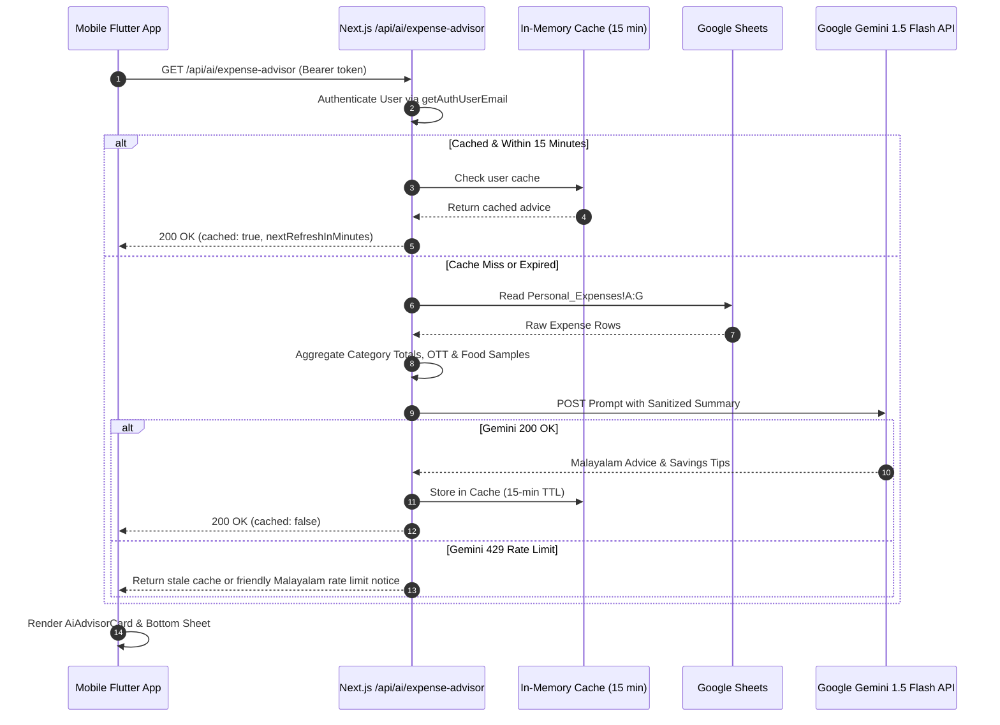

# Feature 09: AI Financial Advisor (Multilingual Malayalam & English)

## 1. Overview & Purpose
The AI Financial Advisor brings intelligent, culturally relevant financial insights directly to family members. Powered by Google Gemini (1.5 Flash), it aggregates recent spending across categories, identifies overspending patterns (especially theater tickets, OTT subscriptions like Hotstar/Netflix, and frequent food deliveries), and provides actionable recommendations in **Malayalam (മലയാളം)**, making financial advice understandable, warm, and practical for all family members.

---

## 2. Source Files & Implementation Matrix

### Backend API (`Manikutti`)
- [`src/app/api/ai/expense-advisor/route.ts`](file:///d:/MERN/Personal/my-apps/finance-tracker/Manikutti/src/app/api/ai/expense-advisor/route.ts):
  - Next.js serverless route accepting `GET /api/ai/expense-advisor?sheetName=Personal_Expenses&forceRefresh=false`.
  - Verifies user authentication via `getAuthUserEmail(request)` (supports mobile Bearer JWT tokens and web NextAuth sessions).
  - Fetches and aggregates expense records via `GoogleSheetsService`.
  - Strips all PII (Personally Identifiable Information) before constructing the prompt.
  - Detects lifestyle spending:
    - **Entertainment/OTT**: Cinema, Theater, Hotstar, Netflix, Amazon Prime.
    - **Food/Dining**: Swiggy, Zomato, Restaurant, Hotel dining.
  - Multi-layer Rate Limiting & Caching:
    - 15-Minute in-memory cache per user (`CACHE_TTL_MS = 15 * 60 * 1000`).
    - 60-Second throttle cooldown (`MIN_COOLDOWN_MS = 60 * 1000`).
    - Gemini HTTP 429 quota fallback to cached response or polite Malayalam notification.
  - Invokes Google Gemini API:
    `https://generativelanguage.googleapis.com/v1beta/models/gemini-1.5-flash:generateContent`.
  - Returns structured JSON containing advice, total expenses, top categories, and cache metadata.

### Mobile Client (`manikutti_mobile`)
- [`lib/widgets/ai_advisor_card.dart`](file:///d:/MERN/Personal/my-apps/finance-tracker/manikutti_mobile/lib/widgets/ai_advisor_card.dart):
  - Premium Stitch Design card pinned on the mobile dashboard.
  - Displays dynamic headline, AI insight paragraph, top spending category chips, and cached status badge.
  - Interactive Draggable Scrollable Bottom Sheet displaying detailed Malayalam insights and tips.
- [`lib/services/api_service.dart`](file:///d:/MERN/Personal/my-apps/finance-tracker/manikutti_mobile/lib/services/api_service.dart):
  - `getAiExpenseAdvice({String sheetName = 'Personal_Expenses'})`: Handles authenticated HTTP requests to the advisor API.
- [`lib/screens/dashboard_screen.dart`](file:///d:/MERN/Personal/my-apps/finance-tracker/manikutti_mobile/lib/screens/dashboard_screen.dart):
  - Integrates `AiAdvisorCard` on the main dashboard directly below the Quick Access Hub.

---

## 3. Data Flow & Prompt Engineering

### Prompt Architecture (Malayalam Financial Coach)
The prompt instructs Gemini to act as **"മണിക്കുട്ടി ഫിനാൻഷ്യൽ അഡ്വൈസർ" (Manikutti Financial Advisor)**:
- Speaks natural, warm Malayalam (മലയാളം).
- Checks if spending on theater/movies or OTT subscriptions (Hotstar, Netflix) is high, recommending pausing unused subscriptions and reducing theater visits.
- Recommends home cooking if food delivery (Swiggy, Zomato) is frequent.
- Structured response with emoji headers:
  - 📊 മൊത്തം ചിലവ് വിലയിരുത്തൽ
  - 🎬 സിനിമ, ഒ.ടി.ടി & എന്റർടൈൻമെന്റ്
  - 🍔 ഭക്ഷണവും പുറത്തുനിന്നുള്ള ഓർഡറുകളും
  - 💡 മണിക്കുട്ടി സമ്പാദ്യ ടിപ്പുകൾ

---

## 4. Edge Cases & Safety Protocols

- **Privacy & PII Protection**: Never send personal names, emails, phone numbers, or account numbers to Gemini API. Only aggregated categories and numeric summaries are passed.
- **15-Minute Rate Limiting & 15 RPM Protection**: Server-side cache avoids exceeding Gemini Free Tier quotas and prevents user spamming.
- **HTTP 429 Graceful Fallback**: If rate limit is hit, gracefully delivers previous cache or friendly Malayalam alert without breaking the client UI.
- **Missing API Key / Gemini Unavailability Graceful Fallback**: If `GEMINI_API_KEY` is not present or Gemini returns 429/400/500, the server automatically engages the built-in Intelligent Malayalam Advisor Engine. It analyzes the actual expenses, entertainment (theater/OTT) spending, and dining (Swiggy/Zomato) spending to provide structured, accurate Malayalam financial insights and savings tips without throwing errors.
- **Empty Ledger**: When no expenses are recorded yet, returns a friendly Malayalam note encouraging the user to log their first expense.

---

## 5. Release & Deployment Details

- **Backend Production Deployment**: Merged to `main` via PR #9, PR #10, and PR #11, deployed to Vercel production.
- **Mobile Release**: Version `2.2.1` (Build `46`), deployed to Firebase App Distribution via PR #31.
- **Intelligent Fallback & Error Resilience**: Added dual-engine architecture (`gemini` + `rule-based`) ensuring users always receive tailored Malayalam advice. Mobile `api_service.dart` decodes server errors and provides clear diagnostics rather than dropping them.
- **CI Submodule Sync Fix**: Resolved merge conflict failure in `.github/workflows/sync-parent.yml` across both `manikutti_mobile` (PR #30) and `Manikutti` (PR #10) by changing `git submodule update --remote --merge` to `git submodule update --init --remote`.

---

## 6. Future Possible Upgrades

- **Conversational Financial Chat**: Interactive chat interface where family members can ask questions (e.g. *"ഈ മാസം എനിക്ക് എത്ര രൂപ ലാഭിക്കാൻ പറ്റി?"*).
- **Predictive Month-End Run Rate**: Estimate month-end total spending based on day-of-month velocity.
- **Audio Voice Readout (TTS)**: Allow the advisor to read out advice aloud in Malayalam using Text-to-Speech for elderly family members.

