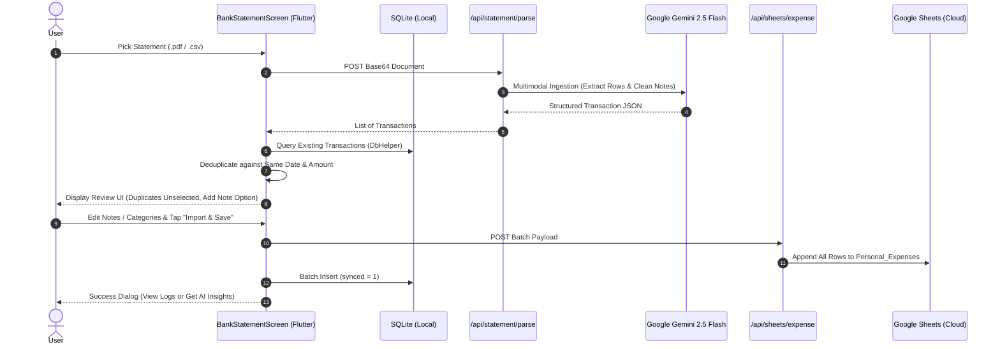

# Feature 13: Bank Statement Upload & Intelligent Ingestion

## 1. Overview & Purpose
The Bank Statement Upload feature allows users to upload monthly bank statements (in PDF, CSV, or Excel formats) to automatically parse all financial transactions. It features an intelligent duplicate detection engine that cross-references candidate transactions with existing records on the same date to avoid double-logging, provides an inline "Add Note" capability for every individual transaction row, batch-syncs approved transactions to Google Sheets (`Personal_Expenses`), and makes them instantly available in the Transactions Log and for AI Financial Insights.

---

## 2. Source Files & Implementation Matrix

### Flutter Mobile Client (`manikutti_mobile`)
- [`lib/screens/bank_statement_screen.dart`](file:///d:/MERN/Personal/my-apps/finance-tracker/manikutti_mobile/lib/screens/bank_statement_screen.dart):
  - Primary UI for bank statement file picking, review, and editing.
  - Interactive file selection supporting `.pdf`, `.csv`, `.xlsx`, and `.xls`.
  - Duplicate detection engine comparing candidate dates (`YYYY-MM-DD`) and amounts with local SQLite records.
  - Filter segmented tabs: `Ready to Import`, `Duplicates Only`, and `All Rows`.
  - Per-row editable note text field and dynamic category dropdown selector.
  - Sticky bottom action bar with total selected count and amount.
  - Post-save celebration bottom sheet directing to `TransactionsLogScreen` or `AiAdvisorCard`.
- [`lib/screens/transactions_log_screen.dart`](file:///d:/MERN/Personal/my-apps/finance-tracker/manikutti_mobile/lib/screens/transactions_log_screen.dart):
  - Added AppBar action button (`Icons.upload_file_rounded`) for one-tap navigation to the Bank Statement upload screen.
- [`lib/widgets/app_drawer.dart`](file:///d:/MERN/Personal/my-apps/finance-tracker/manikutti_mobile/lib/widgets/app_drawer.dart):
  - Added navigation item `Bank Statement` with icon `Icons.upload_file_rounded`.
- [`lib/services/api_service.dart`](file:///d:/MERN/Personal/my-apps/finance-tracker/manikutti_mobile/lib/services/api_service.dart):
  - `parseBankStatement()`: Sends base64 file payload to `/api/statement/parse`.
  - `batchCreateTransactions()`: Posts batch transaction array to `/api/sheets/expense`.
- [`lib/database/db_helper.dart`](file:///d:/MERN/Personal/my-apps/finance-tracker/manikutti_mobile/lib/database/db_helper.dart):
  - `batchInsertTransactions()`: High-performance SQLite batch insertion.
- [`lib/l10n/app_en.arb`](file:///d:/MERN/Personal/my-apps/finance-tracker/manikutti_mobile/lib/l10n/app_en.arb) & [`lib/l10n/app_ml.arb`](file:///d:/MERN/Personal/my-apps/finance-tracker/manikutti_mobile/lib/l10n/app_ml.arb):
  - Added localization keys for bank statement upload and transaction review.

### Next.js Backend & API (`Manikutti`)
- [`src/app/api/statement/parse/route.ts`](file:///d:/MERN/Personal/my-apps/finance-tracker/Manikutti/src/app/api/statement/parse/route.ts):
  - Multimodal Gemini 2.5 Flash / 1.5 Flash parser receiving PDF and CSV statements.
  - Extracts normalized Date (`YYYY-MM-DD`), Amount, Type (`Expense` vs `Income`), Category, Description, and clean Note.
  - Local rule-based CSV fallback parser if Gemini API key is unavailable or rate-limited.
- [`src/app/api/sheets/expense/route.ts`](file:///d:/MERN/Personal/my-apps/finance-tracker/Manikutti/src/app/api/sheets/expense/route.ts):
  - Enhanced POST handler to accept `expenses` array for high-performance single-call batch row append to Google Sheets.
- [`src/lib/googleSheets.ts`](file:///d:/MERN/Personal/my-apps/finance-tracker/Manikutti/src/lib/googleSheets.ts):
  - Added `appendRows()` method to `GoogleSheetsService` for batch appending.

---

## 3. Data Flow Architecture

---

## 4. Duplicate Detection & Prevention Contract
- **Rule**: When parsing transactions from bank statements, if a transaction has the **exact same normalized date (`YYYY-MM-DD`)** and **same numeric amount (`abs(diff) < 0.01`)** with matching type (`Expense`/`Income`) as an existing record in the SQLite database, it is identified as a duplicate.
- **Handling**:
  - Automatically unselected (`isSelected = false`) by default.
  - Flagged with an amber badge explaining the existing match.
  - Segregated under the `Duplicates` tab for transparency, allowing manual user override if identical legitimate purchases occurred.

---

## 5. Password-Protected PDF Support & Zero-Knowledge Decryption
Indian banks (SBI, HDFC, ICICI, Axis, Canara, Federal, etc.) send monthly e-statements as password-locked PDFs.
- **Client-Side Detection**: When a user selects a statement PDF, `BankStatementScreen` detects whether it is password-protected using `syncfusion_flutter_pdf`.
- **Zero-Knowledge Decryption**:
  - Prompts the user with an interactive dialog displaying standard Indian bank password patterns (e.g. SBI name + mobile, HDFC customer ID, ICICI name + DOB).
  - The document is decrypted and unlocked locally on the handset using `PdfLoadedDocument(bytes, password: password)` and removing security before transmission.
  - **Privacy Guarantee**: The user's bank password **never leaves the device** and is never sent across the internet or stored in cloud logs.
  - The clean unencrypted bytes are forwarded to `/api/statement/parse`, ensuring Gemini 2.5 Flash ingests the document without decryption barriers.

---

## 6. Architectural Contracts Preserved
1. **UTC Timestamps**: All saved transactions are normalized to ISO UTC strings (`.toUtc().toIso8601String()`).
2. **Schema Invariance**: Google Sheets `Personal_Expenses!A:G` schema is preserved without alteration.
3. **Offline Resilience**: Batch writes update local SQLite with `synced = 1` immediately, maintaining offline consistency.
4. **Zero-Knowledge Privacy**: Bank statement passwords are processed strictly in local device RAM.
